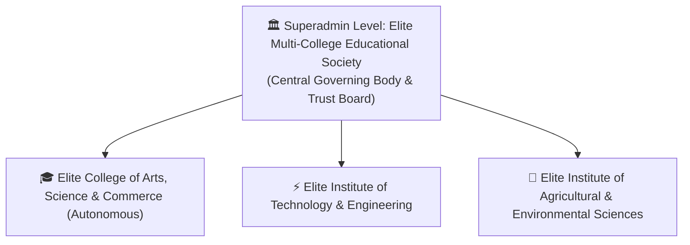

# Elite Multi-College Educational Society — Architecture & Demo Structure

## 1. Overview & Business Purpose
This document outlines the institutional naming architecture and multi-tier organizational model for **Elite Multi-College Educational Society**. 

This structure is specifically tailored for **business and sales demonstration teams** to pitch the CMS/ERP platform to educational trusts, university boards, deans, and autonomous college leadership.

---

## 2. Institutional Hierarchy & Roles

### Tier 1: Governing Trust Level (Superadmin Portal)
* **Official Name:** **Elite Multi-College Educational Society**
* **Subtext:** *Central Governing Body & Multi-Campus Administration*
* **Scope:** 
  * Oversees central educational trust policies, system modules, dynamic schemas, and multi-college deployment.
  * Controls the **Module Studio**, **Card Builder Studio**, design tokens, and trust-wide security credentials.

### Tier 2: Flagship College (Default Login Screen & Main Public Website)
* **Official Name:** **Elite College of Arts, Science and Commerce (Autonomous)**
* **Accreditation / Status:** *Autonomous Senior College — NAAC Grade A++*
* **Scope:** 
  * The primary operational showcase for academic features: Academic Timetables, NIRF, Committees, Departments, Notices, and Alumni Spotlight.

### Tier 3: Multi-Tenant Demo Switcher (1-Click Live Switching)
In the top navigation bar, the business team can demonstrate instant switching between distinct institutions under the same society:

1. **Elite College of Arts, Science & Commerce (Autonomous)**
   * *Focus:* Arts, Pure Sciences, Commerce, NAAC Criteria 1–7, Academic Timetables.
2. **Elite Institute of Technology & Engineering**
   * *Focus:* B.Tech AI & Data Science, CSE, Mechanical, NBA Accreditation, Lab Manuals.
3. **Elite Institute of Agricultural & Environmental Sciences**
   * *Focus:* Agronomy, Soil Science, Sustainable Farming Workshops, KVK Extension.

---

## 3. Key Sales & Business Pitch Angles

| Feature | Pitch Narrative for Clients |
| :--- | :--- |
| **Trust Governance vs. College Autonomy** | *"Trustees and central leadership manage global configurations from one dashboard, while each college retains complete autonomy over its notices, faculty, and syllabi."* |
| **Clean Institutional Credibility** | The name is neutral and prestigious, avoiding conflicts with any prospect college while immediately demonstrating high-volume multi-campus scalability. |
| **Multi-Tenancy in Action** | The 1-click header switcher shows prospects that a single installation can effortlessly power 3, 10, or 50 separate college websites. |
| **Accreditation Ready** | Tailored for NAAC, NIRF, and autonomous compliance workflows right out of the box. |

---

## 4. Implementation Reference (When Ready to Apply)

When scheduled for implementation in code:
1. **`src/data/tenantData.ts`**: Update college tenant profiles and logos to the *Elite Group of Institutions* presets.
2. **`src/components/auth/LoginPage.tsx`**: Update the card title to **Elite College of Arts, Science and Commerce (Autonomous)** under **Elite Multi-College Educational Society**.
3. **`src/components/layout/Header.tsx`**: Update the central governance label for Superadmin mode.
4. **`src/components/storefront/CollegeStorefront.tsx`**: Update the homepage hero banner emblem, header title, and footer copyright.
