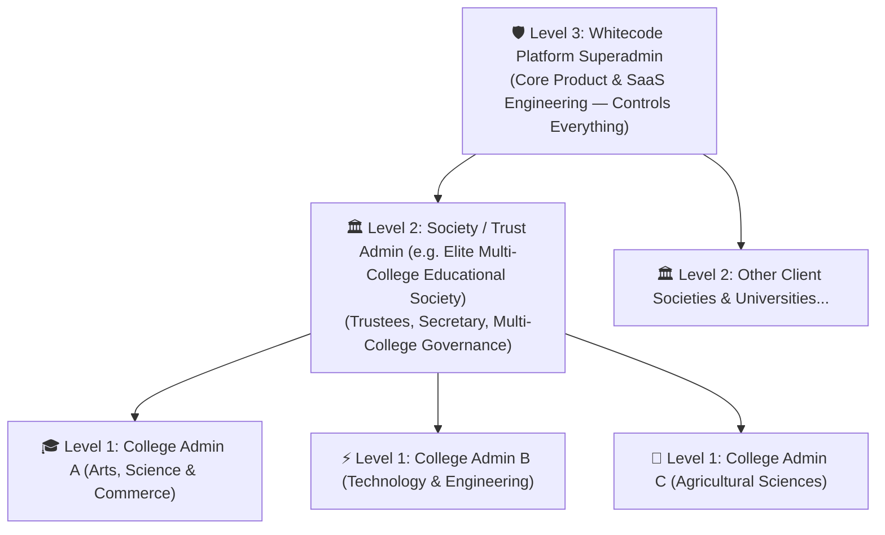

# Elite Multi-College Educational Society — Architecture & 3-Tier SaaS Model

## 1. Overview & Business Purpose
This document outlines the institutional naming architecture, role-based access model, and multi-tier organizational structure for **Elite Multi-College Educational Society**.

This blueprint is specifically designed for **business and sales demonstration teams** to pitch the CMS/ERP platform to educational trusts, university boards, deans, and autonomous college leadership.

---

## 2. 3-Tier Role & Persona Architecture

---

### Level 1: 🎓 College Admin (Single Institution Scope)
* **Target Personas:** College Principal, Registrar, HODs, Department Coordinators, or Faculty Data Entry staff.
* **Scope & Access:**
  * **Strictly limited to their own college** (e.g., *Elite College of Arts, Science and Commerce*).
  * No visibility or editing rights to sister campuses or parent society settings.
* **Functional Modules:**
  * Academic Timetables & Exam Schedules.
  * Department Profiles & Faculty directories.
  * Committees, Cells, and Statutory Bodies.
  * NAAC Criterion Reports (Criteria 1–7) & AQAR metric attachments.
  * Local Notices, Circulars, and Events.
* **Client Value Proposition:** Keeps day-to-day staff focused on their own college data without risking cross-institution data leaks or accidental misconfigurations.

---

### Level 2: 🏛️ Society / Trust Admin (Multi-College Trust Scope)
* **Target Personas:** Trust President, Board of Trustees, Central Registrar, or Group Executive Director.
* **Scope & Access:**
  * **Central Society Dashboard** governing all campuses under the trust.
  * **1-Click Tenant Switcher** to jump into any campus with full administrative authority.
* **Flagship Campuses for Demo:**
  1. 🎓 **Elite College of Arts, Science & Commerce (Autonomous)** — Arts, Pure Sciences, Commerce, NAAC Criteria 1–7.
  2. ⚡ **Elite Institute of Technology & Engineering** — B.Tech AI & Data Science, CSE, NBA Accreditation.
  3. 🌿 **Elite Institute of Agricultural & Environmental Sciences** — Agronomy, Soil Testing, KVK Extension.
* **Functional Modules:**
  * Society-wide circulars and central policy enforcement.
  * Cross-campus analytics (consolidated student strength, accreditation status across all campuses).
  * Institution provisioning under the trust.
* **Client Value Proposition:** Eliminates the headache of managing 5 or 10 separate college CMS logins—trustees get one unified executive dashboard.

---

### Level 3: 🛡️ WhiteCode Master Console (Superadmin)
* **Target Personas:** Whitecode Product, Engineering, and Implementation teams.
* **Scope & Access:**
  * **Platform-Wide Master Control** across all client societies, trusts, and colleges.
* **Functional Modules:**
  * **Module Studio**: Create, customize, and publish new dynamic modules (e.g., NIRF, Scholarships, Grievance Cell) to all institutions with zero redeployments.
  * **Card Builder Studio & Design System**: Configure card styles, CSS tokens, Figma design importers, and master layouts.
  * **Tenant Provisioning**: Spin up new colleges or trusts in under 60 seconds.
  * License tiering, security monitoring, and global AI workflow orchestration.
* **Business Value Proposition:** Zero-code onboarding of new institutional clients and central rollout of features across the entire customer base.

---

## 3. Key Sales & Business Pitch Angles

| Feature | Pitch Narrative for Clients |
| :--- | :--- |
| **Trust Governance vs. College Autonomy** | *"Trustees and central leadership manage global configurations from one dashboard, while each college retains complete autonomy over its notices, faculty, and syllabi."* |
| **Clean Institutional Credibility** | The name is neutral and prestigious, avoiding conflicts with any prospect college while immediately demonstrating high-volume multi-campus scalability. |
| **Multi-Tenancy in Action** | The 1-click header switcher shows prospects that a single installation can effortlessly power 3, 10, or 50 separate college websites. |
| **Accreditation Ready** | Tailored for NAAC, NIRF, and autonomous compliance workflows right out of the box. |

---

## 4. Implementation Checklist

1. **`src/data/tenantData.ts`**: College tenant profiles and branding presets for the *Elite Group of Institutions*.
2. **`src/components/auth/LoginPage.tsx`**: Login screen displaying **Elite Multi-College Educational Society** with **Elite College of Arts, Science and Commerce (Autonomous)**.
3. **`src/components/layout/Header.tsx`**: Role indicator showing Superadmin vs. College Admin with tenant switcher.
4. **`src/components/storefront/CollegeStorefront.tsx`**: Public storefront campus branding and accreditation footer.
5. **`src/services/authService.ts`**: Multi-role credential checks for College Admin, Trust Admin, and Whitecode Superadmin.
